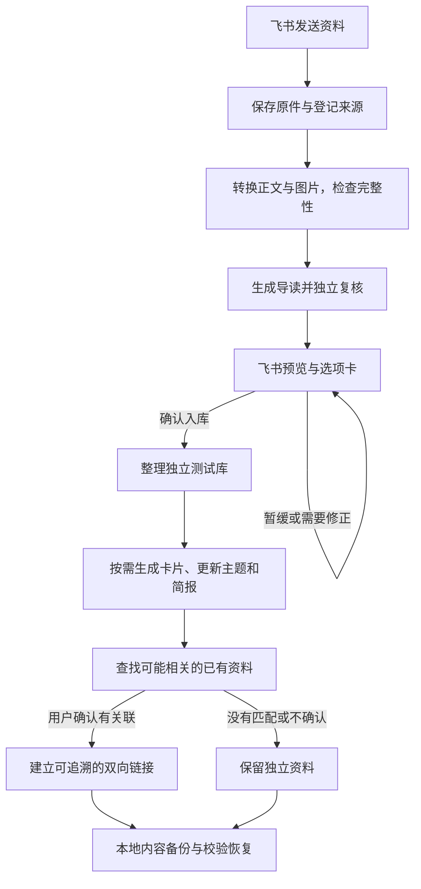

# Feishu Reading KB

从飞书接收阅读材料，在本地保留原件、生成可核对的导读，经确认后整理进独立读书测试库。支持知识卡片、主题索引、简报、资料关联，以及内容备份和恢复工具。

这是开发者使用的工程版本。离线演示可独立运行；连接真实飞书、转换服务和 AI 需要自行配置账号、模型、授权范围和本地路径。仓库不包含任何个人知识库、凭据或运行历史，也不会自动接入使用者的正式知识库。

## 当前能力

- 原件与整理成果分别保留；重复请求、重试和服务重启有持久化状态。
- 中文导读默认简体；直接引文、字形讨论和其他有意保留的繁体内容保持原貌。
- 区分重复页眉页脚与有内容的脚注；疑似识别问题保留待核查状态。
- 公众号解读与论文原文分别生成导读，确认后挂接关系并标明原文；不自动混成综合导读。
- 关联候选供人判断，没有合适资料时允许无关联。
- 存储身份核对、内容备份与恢复工具；真实迁移、建卷和云盘同步需要另外配置与明确执行。

- [系统功能清单](docs/system-functions.md)：模型变更检查、知识库离线回归检查，均按需调用；调用方法和边界集中在此查看。

## 开始使用

先看 [离线开发与测试](docs/development.md)，再看 [配置与归档规则](docs/configuration.md)。实现入口见 [结构与边界](docs/architecture.md)。

本库是后续通用代码的开发与提交入口。运行数据留在本地，代码提交与真实服务部署分开执行。修改已部署服务的代码前，应先停止服务、验证新版本并重新核对部署绑定。

## 隐私与许可

提交前执行 `python3 scripts/check_public_source.py` 和 `python3 scripts/check_public_source.py --history`。检查覆盖暂存内容、全部可达提交及提交身份；它不能替代人工审查。详见 [贡献约定](CONTRIBUTING.md) 与 [安全说明](SECURITY.md)。

项目原创代码使用 [MIT](LICENSE)，署名 **dadaism-Cx**。第三方软件保留各自许可证，见 [依赖说明](THIRD_PARTY_NOTICES.md)。
