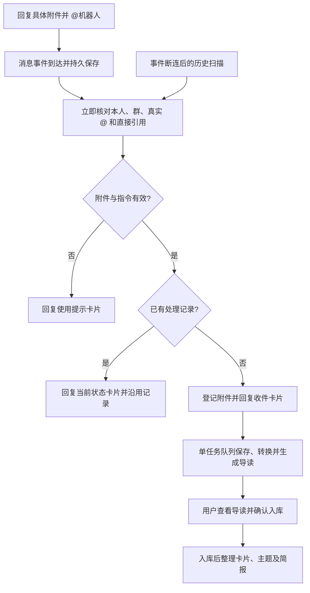

# @机器人即时归档

这项入口将指定附件交给现有归档流程。支持当前已启用的 Markdown、Safari 网页归档和 PDF；不新增来源或正式库写入权限。

## 用法

1. 在指定的本人机器人群中发送附件。
2. **直接回复该附件消息**，从飞书的 @ 菜单选择机器人。
3. 发送“@机器人 归档”，或只发送该 @。

键盘手输的机器人名字不算有效 @。没有引用附件会收到使用提示；引用普通文本、别人的附件或不支持格式会收到说明，不推断最近文件。已经入库、重复、等待确认和暂停的资料均沿用已有记录。



## “即时”的范围

消息事件使用现有的官方 CLI / SDK 长连接，不新启 V1 服务。监听线程先保存最小事件编号，再向平台确认收到；耗时工作不在监听线程运行。调度器每轮（空闲等待约一秒）处理事件，不等待下一次历史轮询。

状态卡片需要网络读取、作用域核验及发送，实际耗时取决于平台和网络；它不是一秒内必达承诺。已有重任务时先排队，不抢占正在处理的资料。磁盘、内存、网络、队列和额度限制继续生效，@ 不增加模型额度，不代替最后的确认入库。

## 去重与恢复

- 消息事件和历史扫描共用指令消息 ID；重复投递、断连重投和重启恢复不会重新创建归档任务。
- 附件继续按原文件消息 ID 和原件摘要去重。重复 @ 仅获取状态，不重做导读。
- 收件卡片先保存内容和发送标识，再发送并回读；未知发送结果使用现有核对流程，不盲目重发。
- 队列满时保留请求；暂时不可读按既有退避间隔继续；不可恢复的错误在本机状态中可见。
- 历史扫描仍受原有七天上限及聊天/已知话题覆盖范围限制，不能保证补回所有离线话题回复；未收到状态时，可重新直接回复附件并 @。

## 部署与验收

代码默认不激活新入口。经批准的私有运行配置需包含已有 `cards` 和：

```json
{"archive_mentions":{"reference":"P46-archive-mention-v1","enabled":true}}
```

飞书应用需在长连接订阅中启用 `im.message.receive_v1`，并具备读取群内 @机器人消息的权限（`im:message.group_at_msg:readonly`）及原归档读写能力。复用原应用、群和身份，不自动申请其他群或个人消息权限。连接就绪只代表 WebSocket 已建立，消息权限和实际事件投送仍需真实验证。

重新构建受限 CLI、冻结已提交源码和依赖、准备新配置，再按明确的验收窗口部署。历史扫描、原卡片确认与新消息事件共用同一个监听进程和累计请求账本。停用时移除新配置项并重新冻结部署；保留请求与资料记录。

离线测试覆盖：真实 SDK 事件结构、作用域和 @ 解析、指令/直接父消息的物理回执、受限下载、原生状态卡片、历史恢复、重复/重启、满队列、延迟重试、重任务期间收件及旧卡片行为。

真实验收建议先使用已处理的合成附件验证事件、卡片与去重，业务模型调用为零；确认收到事件后，再单独安排新附件完整流程。代码测试通过不代表已经部署或具备实际响应时延数据。
