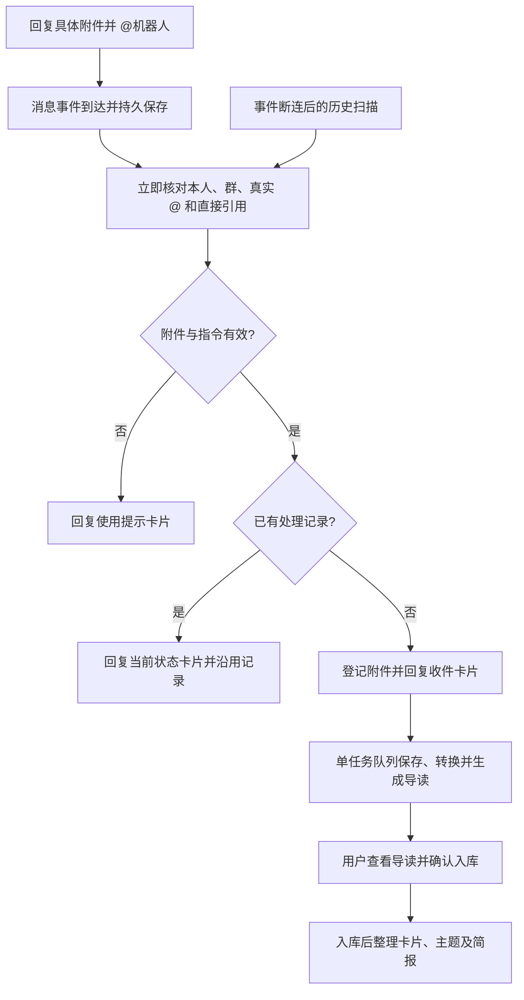

# @机器人即时归档

这项入口将指定附件交给现有归档流程。支持当前已启用的 Markdown、Safari 网页归档和 PDF；不新增来源或正式库写入权限。

## 用法

1. 在指定的本人机器人群中发送附件。
2. **直接回复该附件消息**，从飞书的 @ 菜单选择机器人。
3. 发送“@机器人 归档”，或只发送该 @。

键盘手输的机器人名字不算有效 @。没有引用附件会收到使用提示；引用普通文本、别人的附件或不支持格式会收到说明，不推断最近文件。已经入库、重复、等待确认和暂停的资料均沿用已有记录。



## “即时”的范围

消息事件使用现有的官方 CLI / SDK 长连接，不新启 V1 服务。监听线程先保存最小事件编号，再向平台确认收到；耗时工作不在监听线程运行。调度器每轮（空闲等待约一秒）处理事件，不等待下一次历史轮询。

状态卡片需要网络读取、作用域核验及发送，实际耗时取决于平台和网络；它不是一秒内必达承诺。已有重任务时先排队，不抢占正在处理的资料。磁盘、内存、网络、队列和额度限制继续生效，@ 不增加模型额度，不代替最后的确认入库。

## 指令核验

收到事件后重新读取当前消息，核对本人、指定群、真实 @、精确“归档”指令和直接引用附件。飞书的 `updated=true` 元数据不单独作为否决依据：新发出的提及消息也可能带这个标记。当前内容已改为其它指令或已删除时忽略；附件本身被修改、替换或不属于本人时仍拒绝。提及只提交收件请求，不代替导读后的确认入库。

## 去重与恢复

- 消息事件和历史扫描共用指令消息 ID；重复投递、断连重投和重启恢复不会重新创建归档任务。
- 附件继续按原文件消息 ID 和原件摘要去重。重复 @ 仅获取状态，不重做导读。
- 收件卡片先保存内容和发送标识，再发送并回读；未知发送结果使用现有核对流程，不盲目重发。
- 队列满时保留请求；暂时不可读按既有退避间隔继续；不可恢复的错误在本机状态中可见。
- 历史扫描仍受原有七天上限及聊天/已知话题覆盖范围限制，不能保证补回所有离线话题回复；未收到状态时，可重新直接回复附件并 @。

## 部署与验收

代码默认不激活新入口。经批准的私有运行配置需包含已有 `cards` 和：

```json
{"archive_mentions":{"reference":"P46-archive-mention-v1","enabled":true}}
```

飞书的“事件配置”和“回调配置”各自独立；已有卡片回调正常，不代表接收消息事件已启用。新增事件订阅是平台持久配置，需确认后保存并发布对应应用版本。飞书应用需在长连接订阅中启用 `im.message.receive_v1`，并具备读取群内 @机器人消息的权限（`im:message.group_at_msg:readonly`）及原归档读写能力。复用原应用、群和身份，不自动申请其他群或个人消息权限。连接就绪只代表 WebSocket 已建立，消息权限和实际事件投送仍需真实验证。

重新构建受限 CLI、冻结已提交源码和依赖、准备新配置，再按明确的验收窗口部署。历史扫描、原卡片确认与新消息事件共用同一个监听进程和累计请求账本。停用时移除新配置项并重新冻结部署；保留请求与资料记录。

离线测试覆盖：真实 SDK 事件结构、作用域和 @ 解析、指令/直接父消息的物理回执、受限下载、原生状态卡片、历史恢复、重复/重启、满队列、延迟重试、重任务期间收件及旧卡片行为。

真实验收建议先使用已处理的合成附件验证事件、卡片与去重，业务模型调用为零；确认收到事件后，再单独安排新附件完整流程。代码测试通过不代表已经部署或具备实际响应时延数据。

## 合成附件的真实验收记录

2026-10-23 在 `739b9ea` 上完成有限真实验收，该提交的完整云端检查通过。只使用隔离测试群与此前已处理的合成附件，没有运行模型或新资料入库流程。

| 场景 | 结果 |
| --- | --- |
| 直接回复已处理附件并从菜单选择机器人 @ | 收到消息事件，返回已入库状态卡片 |
| 再次对同一附件发送 @归档 | 返回原状态，未新增归档任务或修改已有资料 |
| 未引用附件时 @归档 | 给出直接回复附件的提示，不猜测最近文件 |

三张卡片均完成接口回读与桌面端显示核验。验收窗口使用48次物理请求、0次模型调用，约4分44秒后停止；资料文件和入库记录前后相等。重复发送指令的去重已实测，没有强制制造平台事件重复投递。

三次事件持久化约0.16–0.24秒，状态卡片的平台创建时间约35–44秒。事件指标受本机与平台时钟差影响，卡片指标使用平台消息创建时间；均不代表客户端绘制延迟，也不是吞吐量或长期稳定性保证。串行读取、范围核验、发送与回读仍有明显等待，不能将此次结果描述为状态卡片即时显示。

此次记录不包含新附件转换、模型导读和确认入库的端到端验收，也不代表日常服务已激活。私人回执、应用与群标识、截图及运行配置留在本地。

## 状态卡片延迟优化

对上述验收的离线分析发现，每个一次性请求会在多个本地检查点反复读取同一份冻结源码和依赖。本轮只减少这部分重复读取；身份、群成员、精确附件、请求预算、去重、发送回读和原有串行调度保持原有流程。

受限 CLI 在进程内保留最近一次完整摘要验证对应的文件状态。本地检查点仍检查完整路径、设备与文件编号、大小、权限、修改时间和状态变更时间；变化后重新校验摘要。校验结果不会写入磁盘或跨进程共享。初始校验以及每次物理联网前仍重算所有文件的完整摘要，长连接启动和连接升级也继续执行完整检查。新增测试覆盖同大小修改并恢复时间戳、文件替换、符号链接、缺失、摘要变化、授权过期、响应期间文件改变，以及物理请求不得相信缓存。

同机离线对照使用原冻结文件集和八个请求检查点，三轮测得：旧实现中位数约3.43秒，更新实现约1.70秒，减少约50%。这是已预热文件系统后的本地完整性校验耗时，不包含身份读取、网络往返、卡片发送或客户端显示；不能据此宣称卡片已达到某个响应时间。合成基准可用 `go test -run '^$' -bench '^BenchmarkFrozenCheckpoints$' -benchmem` 重现两种校验策略的比较。

离线性能对照和真实消息响应分别记录；旧版35–44秒记录继续保留。此优化不自动启动日常服务、不增加业务模型额度，也不启用新资料入库。

## 优化后的真实复测

2026-10-23 在 `4ee6dc2` 上完成新的有限验收，精确提交的完整云端回归通过。使用同一已处理合成附件，三个场景的接口回读和桌面显示均通过：

| 场景 | 事件持久化 | 状态卡片平台创建 | 结果 |
| --- | --- | --- | --- |
| 回复已入库附件并 @ | 0.089 秒 | 23.070 秒 | 返回已入库状态 |
| 再次对同一附件 @ | 0.274 秒 | 24.050 秒 | 沿用记录，未重复入库 |
| 没有引用附件时 @ | 0.054 秒 | 19.146 秒 | 提示直接回复附件，不猜测最近文件 |

前两个场景上次约35秒，本轮约23–24秒，缩短约三分之一。第三项上次存在排队，前后排队条件不同，不计算等条件提速比例。这些数值是三个小样本的实际结果，不是客户端绘制耗时、吞吐量或长期延迟保证。事件耗时涉及本机与平台时钟差异，仅供观察。

本窗口使用48/60次物理请求、0次模型调用；资料文件及既有入库记录逐项不变。完成后服务和监听均停止，日常启动器保持原配置，旧V1未启动。此次未运行新文章转换、模型导读或确认入库流程，不能将合成状态验收等同于新文章完整归档验收。真实回执、配置和截图留本地。
