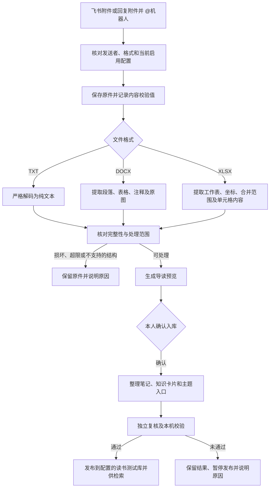

# TXT、Word、Excel 入库

开发版在现有归档流程中增加 `.txt`、`.docx`、`.xlsx`。格式接入与 PDF 表格基础能力共用原件保管、表格结构、导读、确认、整理和检索链路。代码提交不会自动部署或启动服务。

## 支持范围

| 文件 | 保留内容 | 当前边界 |
|---|---|---|
| TXT | 中文正文、换行、行号、实际解码方式；原始文件字节不变 | UTF-8、带 BOM 的 UTF-16/32，以及严格 GB18030；解码失败、替换乱码、二进制控制字符暂停，不静默替换。疑似旧编码建议另存 UTF-8 |
| Word `.docx` | 正文段落与表格顺序、合并单元格、显式表头、简单脚注/尾注、页眉页脚附录、内嵌常见位图 | 不还原物理页码、自动列表编号和样式，批注未读取；图片不自动识读。表内图片保留到附录并注明位置未还原。未标记表头的表格不推断业务含义。修订、正文域、文本框、隐藏文字、符号字体、内容控件、数学对象等暂停并提示转普通正文或 PDF |
| Excel `.xlsx` | 所有受支持工作表的数据范围，工作表名称、A1 坐标、隐藏行列状态、合并范围、空值与零、原数字格式 | 坐标表头由系统生成，不是业务表头。公式只保留表达式，不计算、不使用缓存值。百分比等保留存储值与格式，不冒充 Excel 显示结果。图表、批注及排版未识读；内嵌位图保留到附录 |

Excel 读取库的 `data_only` 只决定读取公式还是文件内已有缓存，不执行计算，因此这里采用公式原文并标明未计算。[openpyxl 官方说明](https://openpyxl.readthedocs.io/en/stable/_modules/openpyxl/reader/excel.html)

旧版 `.doc`、`.xls` 需先另存为 `.docx`、`.xlsx`。加密文件、宏文件、嵌入对象、外部图片/数据依赖不自动处理。普通超链接只保留显示文字，不访问链接。转换过程中不启动 Word、Excel，不执行宏、公式或外部命令。

## 完整性与资源限制

- 单文件最多 32 MiB；Office 展开总量最多 64 MiB，单个内部条目最多 16 MiB，最多 2000 个条目；拒绝重复路径、不安全路径、XML 实体与异常压缩比例。
- Excel 最多 100 张工作表；数据矩形总量最多 5 万格，单表最多 1 万行、256 列。远处单元格导致的巨大空区域也计入，防止内存异常。超过范围提示拆分，不只取前几行。
- 转换正文有单独大小限制；提交 AI 前还核验当前导读的字符数、字节数和图片上限，超限不预留模型次数。
- 原件始终完整保存。转换文本、结构位置、图片分别校验；图片引用变更会同步更新结构偏移，不能沿用失效坐标。
- 结构校验通过不等于事实或数值正确。超长表格仍可定位，自动回答继续遵守 [表格问答限制](pdf-tables.md)。

## 启用与回退

新部署的导读配置使用 `reference: office-documents-guide-v1`，格式列表固定为 `[".md", ".webarchive", ".pdf", ".txt", ".docx", ".xlsx"]`，同时保留原有身份、正文及图片边界。PDF 仍须已有 PDF 配置启用。

消息轮询、@ 入口、下载授权及模型委托读取同一份格式配置；旧配置不会自动放宽。依赖安装在项目运行环境，版本见 `requirements.lock`。发布时更新冻结源码和依赖清单，并验证下载守卫、导读配置以及启动器绑定；本轮开发不修改已批准部署、不恢复服务。

配置回退不会删除新格式原件或已经生成的资料。已被旧服务判定为不支持的历史 TXT 不会自动重新开始，需在部署后检查原记录，再安排受控接续或重新提交，避免重复入库。

## 验证边界

离线测试采用生成的中文 TXT、Word、Excel，检查原件一致性、编码、完整工作表、公式标识、合并单元格、隐藏数据、图片、坏文件、资源限制、@ 入口、导读预览和本人确认后的整理发布。模型与飞书通讯均用合成适配器。

离线通过只证明程序链路与约束，不证明真实 AI 导读质量或真实飞书部署成功。真实材料验收和服务启用应单独记录，不重置任何历史累计账本。
