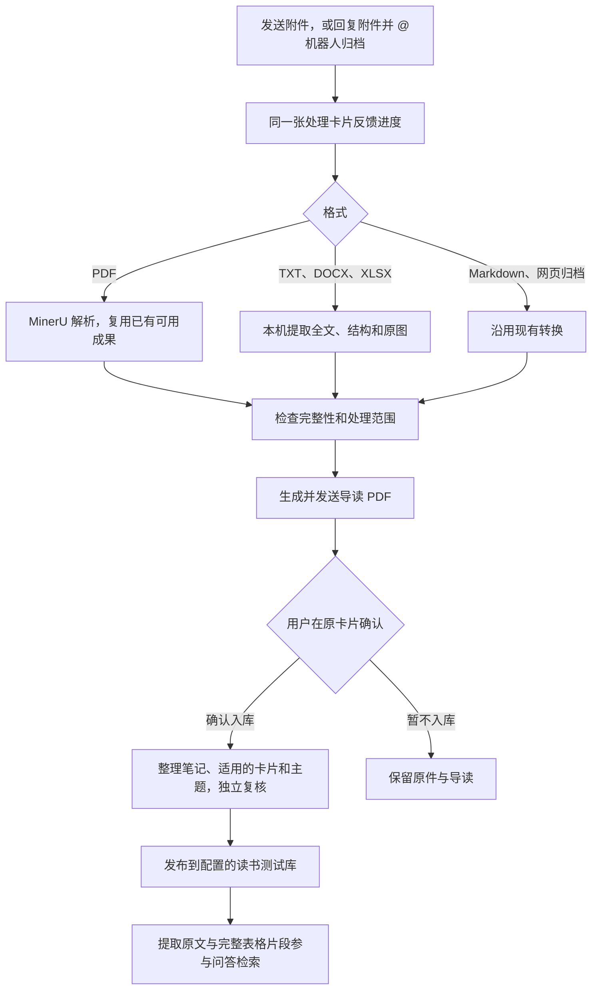

# 文档格式整合发布

本轮将既有 TXT、DOCX、XLSX 与 PDF 表格能力接入同一版本，保留单篇处理卡片、逐篇确认、整理与独立复核、过程耗时、日常用量记录及 PDF 原样换行读取。各机器的实际启用状态仍以本机启动器和冻结配置为准。

## 可使用的流程

普通文本、Word、Excel 转换不启动 MinerU，也不启动 Office 应用。仍按现有资源准入规则执行，未合并或取消内存检查。旧版 DOC/XLS、宏文件、加密文件及不支持的复杂结构不在本轮范围，具体内容与容量边界见 [文档格式](document-formats.md)。

表格结构、显式表头与跨页关系沿用 [表格归档与问答](pdf-tables.md) 的保守规则；不执行 Excel 公式，不自动验证 OCR 数值，不开展跨表计算。

## 与已发布版本的兼容

阶段五把重复的整理上下文集中保存到 `reading-input-storage/v1`，模型输入保持原样。本轮让问答来源读取统一经过同一个还原与完整性核验入口，支持新格式及旧的展开格式；不会重写历史输入、模型请求、回执或知识库正文。

新格式仍先送导读，再由本人确认入库。已完成资料不重新整理；旧 TXT 拒收记录不自动重试。等待补充信息的材料继续等待原回复，已发送或结果不明的请求不因升级而自动重发。存在正在生成、未核对回执或已签名请求与新程序不一致时，先完成或处理原任务，再切换，不批量修改账本解决兼容问题。

## 部署组成

部署需要同时绑定：冻结源码、支持新格式的本地下载守卫、锁定的 Office 依赖、`office-documents-guide-v1` 导读配置、同一队列与读书库、以及启动器。导读格式固定为 `.md`、`.webarchive`、`.pdf`、`.txt`、`.docx`、`.xlsx`；只改文件扩展名名单不能代替完整部署。

Office 依赖放入独立项目目录并纳入冻结清单，保留原依赖和回退配置。格式整合不变更身份、知识库位置、模型、累计用量、授权时间边界和备份设置。真实路径与部署记录只留本地。

切换前核对服务停止、任务状态与账本摘要；切换后执行本地配置检查。是否启动日常服务和是否进行真实飞书验收分别记录，不把检查通过写成服务已运行。

回退前检查新增 DOCX/XLSX/TXT 未完成任务及表格索引版本。停服后切回旧冻结启动配置；新格式任务保留待接续，不向旧程序强行投递；不覆盖数据库、不删除成果或重置用量。索引按对应版本的正常同步机制重建，正文不回退。

## 本轮验证范围

合成联调覆盖三种新格式的 @归档、原件保管、同一处理卡片、导读、用户确认、整理、独立复核、发布及已入库正文检索。同时核验表格目录、重复 @ 不重新入库、新旧整理快照可读、普通 PDF 及特殊换行、格式拒收和受控下载边界。

测试通过说明程序链路与约束符合预期，不代表真实飞书展示、模型阅读质量或表格 OCR 准确率已完成验收。批量问答质量回归仍属独立按需工作，本轮不触发。
