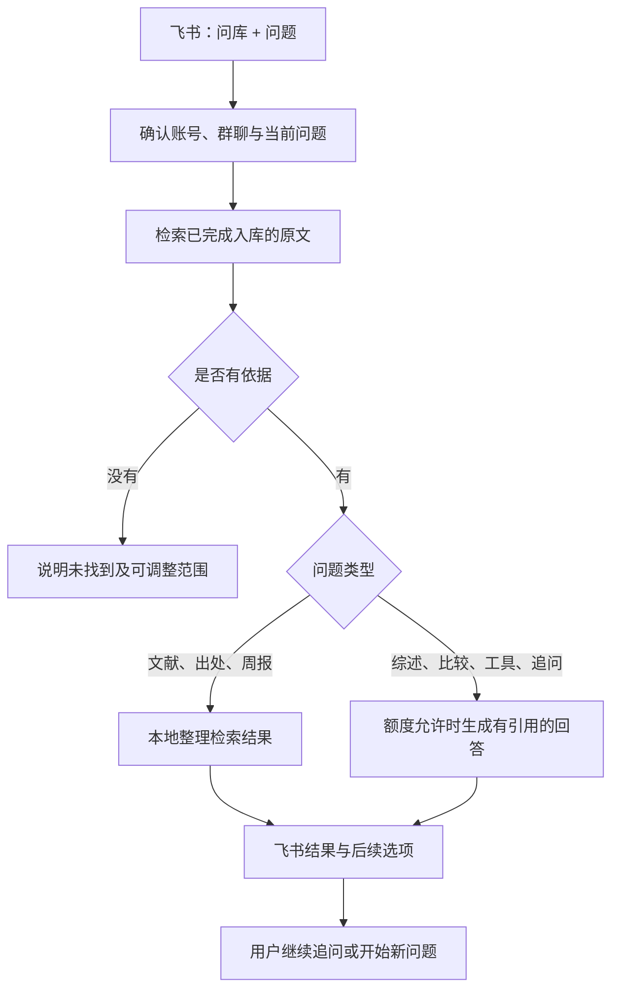

# 测试库问答

问答仅访问当前服务已批准入库且完成整理的测试资料。个人正式知识库、待处理目录、历史问题清单不自动接入。

## 检索基础

- SQLite FTS5 索引保存在服务私有运行目录，可重建，不改写知识库。
- 中文按相邻双字分词，英文按词分词；按匹配比例及 FTS 排序，轮流取不同资料的段落。此轻量首版不依赖向量模型，未命中可换用原文关键词。
- 仅索引有完成事件、复核记录及匹配原文的资料。复核输入、来源正文或版本变化会阻止旧依据继续使用。
- 导读、知识卡片和主题入口不会被算作独立研究证据。
- 引用保留来源身份、正文摘要哈希、段落与字符位置。没有可信物理页映射时不生成页码。
- 已核定的重复页眉、页脚不参与正文证据；脚注和补充说明保留。
- 发表年份、完成入库时间分别处理；“最新/现行”不按入库时间判断。
- 周报统计完成整理事件，并排除 `brief_visibility=exclude` 的标题和数量；不把入库等同于阅读或项目完成。

## 隐私与开发

公开仓库只保存通用程序和合成回归。索引、对话、模型请求、原文和真实验收记录全部留在本机被忽略的运行目录。真实飞书启用与模型额度须在部署配置中明确绑定；代码提交不自动启用服务。
