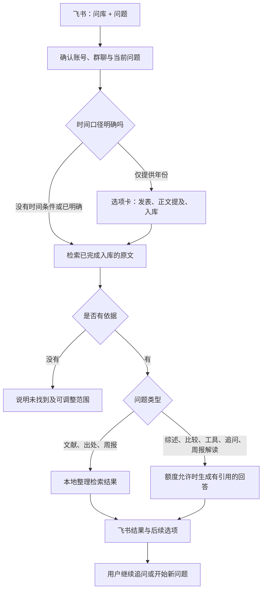

# 测试库问答

问答仅访问当前服务已批准入库且完成整理的测试资料。个人正式知识库、待处理目录、历史问题清单不自动接入。



## 检索基础

- SQLite FTS5 索引保存在服务私有运行目录，可重建，不改写知识库。
- 中文按相邻双字分词，英文按词分词；按匹配比例及 FTS 排序，轮流取不同资料的段落。此轻量首版不依赖向量模型，未命中可换用原文关键词。
- 仅索引有完成事件、复核记录及匹配原文的资料。复核输入、来源正文或版本变化会阻止旧依据继续使用。
- 导读、知识卡片和主题入口不会被算作独立研究证据。
- 引用保留来源身份、正文摘要哈希、段落与字符位置。没有可信物理页映射时不生成页码。
- 已核定的重复页眉、页脚不参与正文证据；脚注和补充说明保留。
- 名称扩展限于常用中英文术语及原文明确声明的简称；最多尝试八种写法，不把相关主题推断成同义词。
- 年份不明确时先用固定选项询问。支持明确年份区间、去年、今年、近若干年和世纪年代；澄清不调用模型。
- 正文时间只筛选提及指定年份的片段，不宣称核定了事件发生时间。发表年份、完成入库时间分别处理；“最新/现行”不按入库时间判断。
- 周报统计完成整理事件，并排除 `brief_visibility=exclude` 的标题和数量；不把入库等同于阅读或项目完成。

## 隐私与开发

公开仓库只保存通用程序和合成回归。索引、对话、模型请求、原文和真实验收记录全部留在本机被忽略的运行目录。真实飞书启用与模型额度须在部署配置中明确绑定；代码提交不自动启用服务。

## 飞书用法

在原来已授权的机器人群聊发送：

| 需求 | 示例 |
| --- | --- |
| 查文献 | `问库：查文献 城市演变` |
| 手机取阅原件 | 结果卡片选择“取阅原件”，或发送 `问库：原件 1` |
| 查逐字引文出处 | `问库：查出处 “原文中的一句话”` |
| 原文支持的综述 | `问库：综述 城市演变有哪些方法` |
| 指定发表年份 | `问库：查文献 城市演变 发表:2010-2020` |
| 指定正文提及的年份 | `问库：查文献 城市演变 内容:1990-1999` |
| 指定入库年份 | `问库：查文献 城市演变 入库:2026` |
| 澄清自然语言时间 | `问库：查文献 近三年城市演变研究`，再点选时间口径 |
| 比较所选材料 | 先查文献，再发 `问库：比较 1,2 适用条件` |
| 连续追问 | `问库：追问 这一方法有哪些限制` |
| 库中工具 | `问库：工具 数据整理` |
| 周报观点总结 | `问库：周报解读`，也可在普通周报选项中选择；使用一次模型调用 |
| 周报 | `问库：本周周报` 或 `问库：周报 2026-01-01 至 2026-01-07` |
| 清除上下文 | `问库：新问题` |

回复附有“查看原文依据 / 本周周报 / 新问题”卡片。每张卡片仅接受一次选择，重复点击不重复执行业务。问句需要 `问库：` 前缀；普通归档确认不进入问答。聊天和话题分别保存最近问题及材料选择，六小时后失效；不以旧回答作为证据。每次最多比较四份，检索最多展示八份来源、十二个片段。

## 部署配置

现有 P32 私有运行规则增加可选 `qa` 配置，必须同时启用既有 `reading` 和 `cards`。配置示意如下，路径、启用时间和账号摘要由本地部署工具填写并冻结：

```json
{
  "qa": {
    "reference": "P43-qa-v1",
    "enabled": true,
    "since": 0,
    "script": "<reviewed-worktree>/projects/deepseek-harness-feishu-bridge/feishu-gateway/src/pilot-knowledge-qa.mjs"
  }
}
```

`since` 实际使用部署时刻，防止重新处理历史问题。省略 `generation` 时只返回原文检索，不调用模型。启用生成时，另行明确 `enabled`、`account_sha256`、`wait_seconds`（1–1200）和 `minimum_remaining_percent`（5–99）。问答和归档共用原 `daily_models` 累计上限；没有独立的隐性额度，也没有按重启重置。模型超时或结果不明不自动重试。

代码发布使用固定版本快照，原运行根目录、知识库路径及数据库继续保留。新版模块通过冻结依赖清单绑定；不要通过复制数据库建立第二份运行账本。先执行配置检查，再从原启动器切换入口，失败可恢复原入口配置。真实服务验收需要另行明确账号、群聊、时间、请求上限和业务模型额度。

当前实现对引用做逐字校验，无法用此校验代替语义判断。自动回答会说明使用范围；真实效果需用本地材料验收。中文检索只扩展明确名称，不自动理解全部同义词，版本效力未确认时返回候选资料而不判定“现行”。

回答默认显示简版，保留完整结论的句子；“查看原文依据”提供本次已核验的完整主张、引文与定位，不再调用模型。比较所选材料时，若模型没有引用其中一份，界面明确显示“尚未完成比较”，不把单篇概括当作完整比较。


普通周报不调用模型，按已记录关键词汇总本期主题，并标记此前可展示的库内记录中没有出现过的关键词。这只是库内新增情况，不能解释成研究突破或工作完成。

“周报解读”先限定完成入库的时间范围与简报可见性，再从最多八份资料、十二个原文片段整理重要观点。结果同时保留普通统计、实际抽样范围和逐字引用。点击历史周报选项沿用该次周报时间；资料或展示权限随后改变时停止发送。超过取样上限时明确说明覆盖范围，可缩短周报区间；不声称穷尽所有资料。真实回答质量仍需要实际材料的语义验收。


## 原件入口与离线评测

原件入口读取已入库资料对应的原飞书消息，核对本人、原群聊、原附件及保管摘要后，使用平台返回的位置或消息链接定位附件。在手机飞书中打开原消息后预览或下载；没有重新上传知识库文件。原消息删除、附件改变或平台未提供定位信息时明确说明，缺失位置不由消息 ID 猜测。不同客户端上的实际跳转效果仍须真实验收。

新结果采用独立卡片菜单，已发出的旧卡片保持原选项。原件与时间选项只对应其来源问题，六小时后需要重新查询；清空当前上下文不会让旧选项指向另一篇资料。

`qa_evaluation.evaluate(index, cases, now=...)` 支持 1–1000 条独立标注的离线检索题。每题指定 `id`、`question`、`expected_mode`、`expected_materials`，可带比较或追问所需的 `context`。报告保留逐题结果、前五来源命中率、预期来源召回率、无依据题及时间澄清题；不调用模型，不把检索成绩写成回答语义准确率。真实题库、期望来源与报告只能保存在本地忽略目录；公开测试使用独立合成材料。

历史问题清单可以帮助挑选题型，不能作为回答事实来源。项目进度、成果承诺、政策现行性等问题需要对应原件进入当前授权库后再评测；仅凭几个测试材料无法证明这些业务问题已经得到全面覆盖。
