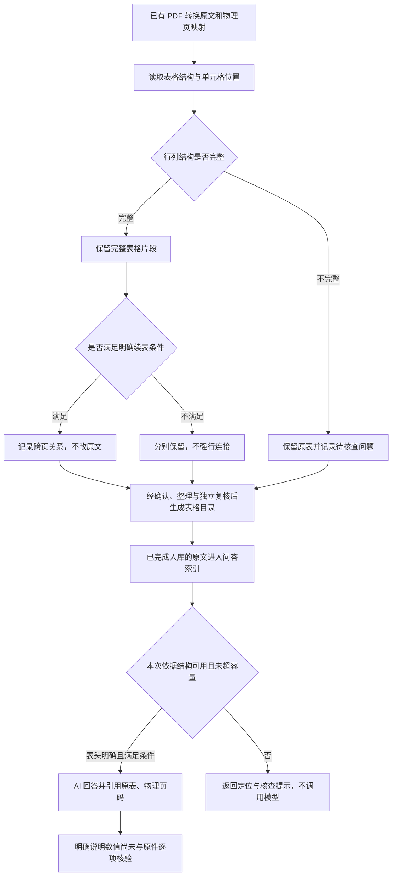

# PDF 表格归档与问答

本版增加表格目录、单元格位置、保守的跨页续表关联，以及表格完整片段检索。它接在已有 MinerU 转换结果之后，不重新识别图片、不改写原文。代码发布与本机服务部署分别进行；仓库有这项能力不代表某台机器已经启用。

## 用户能得到什么

| 能力 | 本版行为 | 使用边界 |
| --- | --- | --- |
| 原表保存 | 保留完整 HTML 表格、表名、表注、单位及已有原图 | 不填补缺失数值，不将空白、破折号替换成零 |
| 单元格记录 | 记录行、列、合并范围、原文字面值与字符位置 | 行列结构一致不能证明 OCR 数字正确 |
| 表格目录 | 新归档生成 `表格目录.md`，链接提取原文、表格记录和随材料保存的 PDF | 物理页码来自已校验的转换映射；没有映射就不编页码 |
| 跨页续表 | 只有明确标“续”、编号/表名/单位及表注明确一致、显式表头一致且物理页相邻时才关联 | 每页片段各自保留，不合并原文、不去重数据行；无显式表头不自动关联 |
| 问答检索 | 完整表格片段一起检索，避免普通 900 字切片拆散表头和数值 | 单片段最多 12,000 字符，总回答依据最多 24,000 字符 |
| 核查提示 | 结构异常、表头未明确或表格过长仍可通过表内词语找到原表入口 | 本次命中这些表格时只返回检索定位，不调用模型猜数值 |
| 整理与独立复核 | 两个模型请求都获得表格结构提示；草案不能引用结构或表头未明确的原表单元格形成知识主张 | 其他正文仍可正常整理，问题表格连同限制保留；独立复核未通过仍按既有流程暂停 |

如识别器只输出普通单元格，系统会提示“表头未被识别器明确标记”，保留原表定位，暂不将表内内容用于 AI 结论。矩形行列也可能发生文字串列或单位丢失，必须另行完成原页核查后再推进这类表格的自动问答。显式表头只代表结构条件具备，仍不证明 OCR 数字准确。

原有“预览后逐篇确认入库”和独立复核要求继续适用。上图的结构检查不代替这些步骤，也不增加模型调用次数。

## 怎样使用

部署新版后，按原来的飞书归档流程发送 PDF、查看导读并确认入库。整理完成后，在本地材料的来源卡片进入“表格目录与核验状态”。

飞书问答沿用现有命令，例如：

- `问库：查文献 合成区域面积`：查看命中的原表位置。
- `问库：合成甲区的面积是多少，单位是什么？`：在有可用原表片段时生成回答。
- `问库：原件 1`：打开最近结果第 1 份材料的原件，按显示的 PDF 物理页码核查。

“物理页码”是 PDF 查看器中的页序号，可能与论文印刷页码不同。未检索到全部续表时，回答不能声称已统计全表；多页汇总和数值计算暂不自动执行。

旧资料不自动重写、不重新入库。首次查询时可从已完成入库的原文重建表格索引；表格目录文件只随新归档生成。原件入口仍使用既有机制。

## 开发与验证边界

实现入口为 `table_evidence.py`。使用 CommonMark 与 Python HTML 解析器处理实际 HTML 表格，排除代码示例与 HTML 注释中的假表格；保留 Unicode 字符位置、实体原始拼写与文件摘要。非法合并范围、缺格、重叠、嵌套、标签未闭合和超限结构均显式记录。

新归档在 `入库依据/提取/tables.json` 保存派生记录。它与提取正文摘要绑定，并纳入发布文件清单。问答始终重新读取已复核原文及页码映射，重新计算表格位置与结构；索引和派生记录不能自行充当原文依据。索引的派生版本变化通过正常同步重建，不迁移或覆盖知识库正文。

表格中文字需要作为引文显示时，生成笔记对 HTML 标签做转义，避免把引文执行为标签。原文与引文校验使用转义前内容。

合成回归覆盖：多行表头、跨行跨列、正负号/小数/百分比、空白与零、Unicode 与 HTML 实体、注释及代码示例、空行、非法结构、续表编号/单位/表注/页码变化、超长表导航、索引重建、定位篡改、归档目录和模型调用前的边界检查。运行方法参见 [离线开发与测试](development.md)。

这些测试验证结构、定位与程序流程。**真实 PDF 的单元格识别准确率、AI 对表格问题的语义回答质量，仍需使用原页对照样本另行验收**，不能用合成测试通过代替。当前尚未实现自动图像复核、低置信单元格自动修复、无表头续表推断、超长表按行分批回答及跨表统计计算。

## 部署与后续工作

1. 离线测试与公开内容检查通过后提交代码，并完成当前提交的云端检查。
2. 部署时遵循既有本机服务规则，核验旧任务与已保存请求，保留原配置、账本和回滚版本；不把新提示词套到旧的已签名请求上重试。
3. 使用明确批准的小样本，对原 PDF 页、表头、数值与单位逐项核验，再检查飞书展示和模型回答。日常运行授权不自动授权批量质量评测。
4. 根据误差记录再决定是否增加图像复核和超长表行级问答，不提前宣称复杂表格已完全支持。
