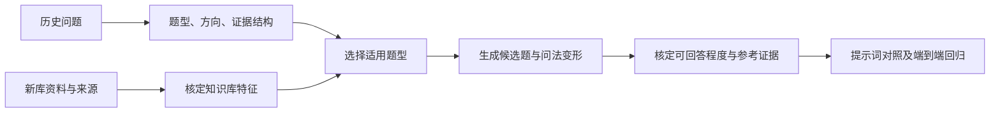

# 从历史问答提炼可迁移的测试题型

历史问题用于发现用户需要哪些回答能力。新知识库的测试题必须从新资料的内容和证据关系出发，不能仅替换旧问题中的专有名称。



## 问题的四个维度

- **类型**：希望系统完成什么思考任务，例如比较、找出处、判断可行性。
- **方向**：关注什么，例如时间、职责、字段口径、适用条件。
- **证据结构**：单份原文、多份比较、时间记录、版本链或结构化数据。
- **边界与风险**：证据是否足够，能否确认现行性，是否需要计算或图像理解。

`qa_test_design.BLUEPRINTS` 提供 15 类模板：概念与边界、清单与覆盖、出处与依据、异同比较、要求对应、关系依赖、历史进展、版本变化、综合总结、方法建议、可行性、完整性缺口、字段口径、数量核算、方案组织。每类包含方向、适用特征、最低来源数、基础问法、同义问法和评分检查点。

## 根据新库特征生成候选题

`design_candidates(profile, limit=100, paraphrases=False)` 是纯本地函数，不读取磁盘、不调用模型、不联网，不接入日常服务。调用方先建立以下结构：

```json
{
  "corpus_id": "synthetic-orbit-v1",
  "capabilities": ["text"],
  "sources": [
    {"id":"a","title":"轨道测量实验","role":"original","body_sha256":"aaaaaaaaaaaaaaaaaaaaaaaaaaaaaaaaaaaaaaaaaaaaaaaaaaaaaaaaaaaaaaaa"}
  ],
  "subjects": [
    {"id":"orbit","label":"轨道测量","source_ids":["a"],
     "feature_evidence":{"definitions":["a"],"research_findings":["a"]}}
  ]
}
```

示意中的哈希不是实际证据。真实使用须读取正文计算摘要，并核对每项特征对应的来源。支持的特征见 `FEATURES`，未提供的特征不会从文件名或题目中猜出；比较和版本类题需要至少两份不同来源。角色标记由资料核验产生，不能因模型解释而自动赋予“官方”身份。

输出的每题包含：类型、方向、所需能力、候选证据及哈希、来源角色、评分要点、题目家族和变体关系。所有题均为 `gold_status=unreviewed`、`answerability=null`。绑定来源 ID 仅建立可复查关系，不证明这些来源足以回答，也不等于金标准已经核定。资料或特征无法确认时，缺口要显式报告。

基础题和同义问法共享 `parent_group`；切分开发集、回归集和保留集时必须整组划分。返回题量受上限限制时不拆开题目对，遗漏家族单独报告。生成同义句后仍需复核是否保留原意；改变时间、对象或比较范围属于另一类变化，需要重新核定期望答案，不能沿用旧答案。

数量核算类题若系统没有表格能力，会标记为 `capability_boundary`，用于检查能否诚实说明能力限制；不能把安全拒答记作成功完成核算。

## 三条评测线

1. **提示词对照**：固定问题、证据包、模型及参数，只改变提示词；匿名比较答案，报告胜/平/负及关键错误。不能把检索差异归因于提示词。
2. **问题变化**：同义改写测试稳定性，时间/范围变化测试敏感性，追问测试上下文边界。近重复题不得跨开发集与保留集。
3. **跨库与端到端回归**：将通用规则用于不同资料画像，逐库报告检索与回答成绩；新库未测试前，只能声称工具支持换库。合成异领域测试验证程序行为，不能证明真实跨库回答质量。

知识库画像目前由核验后的结构化输入提供，尚未实现从任意知识库自动识别特征、金标准标注或模型裁判。后续应先建立只读资料适配器，再校准特征识别；不在此函数里添加自动入库或联网能力。

真实历史题、资料画像、原文、哈希清单和报告只存本地忽略目录；公开仓库使用独立合成示例。使用现有累计账本，新评测预算不得绕过或重置。

评测方法参考 [OpenAI evaluation best practices](https://developers.openai.com/api/docs/guides/evaluation-best-practices)：按真实任务构建题目，结合自动检查与人工校准，并留意模型裁判的位置和篇幅偏差。本模块不依赖云端评测服务。
